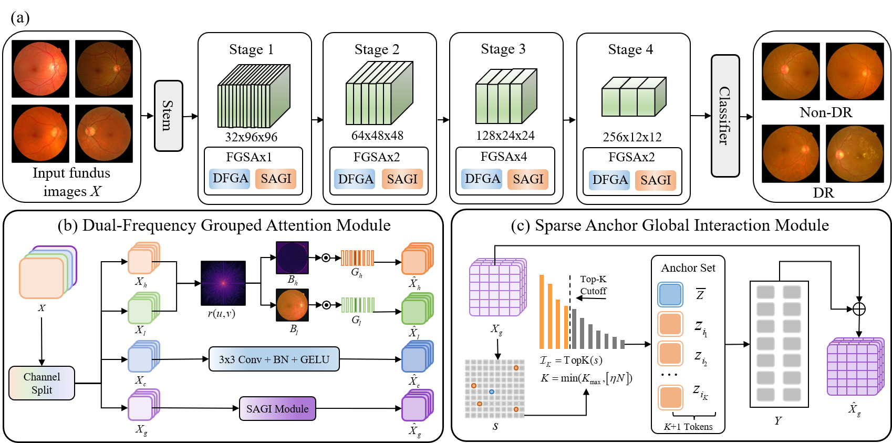
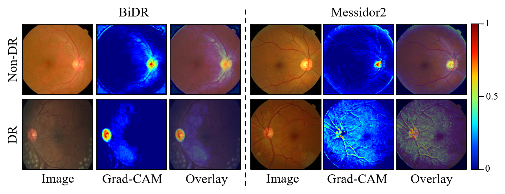

# FGSANet

Official training code for **Frequency-guided Sparse Attention Network (FGSANet)** for diabetic retinopathy (DR) classification from color fundus images.

The repository contains the FGSANet model, training and evaluation pipeline, and a manifest builder. Dataset images and trained checkpoints are not included.

## Task setup

Both datasets are used for binary classification:

- **BiDR:** label 0 is No-DR; label 1 is DR. The official train/validation/test folders are retained.
- **Messidor2:** original grade 0 is mapped to No-DR; grades 1--4 are mapped to DR. The data is split by class into train/validation/test sets with a 70/15/15 ratio. The manifest split seed defaults to 42.

## Requirements

Python 3.10 or later and a PyTorch installation matching your CUDA version are recommended.

```bash
pip install -r requirements.txt
```

## Dataset layout

Set `DR_DATA_ROOT` to the directory containing both datasets. The expected layout is:

```text
<DR_DATA_ROOT>/
+-- BiDR/retino/{train,valid,test}/{No_DR,DR}/...
+-- Messidor-2 Dataset/
    +-- messidor_data.csv
    +-- messidor-2/messidor-2/preprocess/...
```

The Messidor2 CSV must contain `id_code` and `diagnosis` columns. No image data is redistributed in this repository; obtain and use each dataset under its own terms.

## Build manifests

Run from the repository root:

```bash
export DR_DATA_ROOT=/path/to/DR
python scripts/build_dr_splits.py
```

This creates `manifests/dr/by_dataset/{BiDR,Messidor2}/{train,val,test}.csv`. BiDR uses its provided split. Messidor2 is split independently and stratified by the binary label.

## Train

Run all datasets with three seeds (0, 42, and 123):

```bash
export DR_DATA_ROOT=/path/to/DR
bash scripts/run.sh
```

The default configuration uses 384-pixel inputs, batch size 16, 100 epochs, AdamW, and class-balanced focal loss with label smoothing. Override settings with environment variables, for example:

```bash
DATASETS="Messidor2" SEEDS="0" BATCH_SIZE=8 bash scripts/run.sh
```

To train a single run directly:

```bash
python dr_pipeline/train.py \
  --data-root "$DR_DATA_ROOT" \
  --dataset Messidor2 \
  --model fgsanet \
  --seed 0
```

The ablation variants `ours_base`, `ours_dfga`, and `ours_sagi` are also supported. `ours` remains an alias for `fgsanet`.

## Evaluate a checkpoint

```bash
python dr_pipeline/test.py \
  --checkpoint runs/dr_cls/Messidor2/fgsanet_seed0/best.pt \
  --data-root "$DR_DATA_ROOT"
```

The best checkpoint is selected using validation AUC. For binary classification, the default training pipeline selects a decision threshold using validation balanced accuracy and then applies it to the test set. Set `--no-threshold-search` to use the default 0.5 threshold.

Training metrics, configuration, predictions, and checkpoints are saved under `runs/dr_cls/<dataset>/<model>_seed<seed>/` (for example, `runs/dr_cls/Messidor2/fgsanet_seed0/`).

## Figures

### FGSANet architecture



**Figure 1.** FGSANet overview and attention modules. Panel (a) shows the four-stage classifier, with DFGA and SAGI blocks in each stage. Panel (b) illustrates DFGA's channel grouping and parallel high-frequency, low-frequency, local, and sparse global branches. Panel (c) details SAGI's Top-K salient anchors, global mean anchor, and sparse feature interaction.

### Grad-CAM visualization



**Figure 2.** Grad-CAM examples for FGSANet. Each example shows the fundus image, its class activation heatmap, and the heatmap overlaid on the input. The visualizations show where the model's prediction is most responsive in the retinal image.

## Model implementation

The proposed method is implemented in `model/fgsanet.py`. Its main components are named `DFGA`, `SAGI`, `FGSA_Block`, `FGSA_Stage`, and `FGSANet` to match the paper. The file retains the Microsoft MIT attribution for the LWGANet-derived stem, downsampling, and auxiliary attention components.
